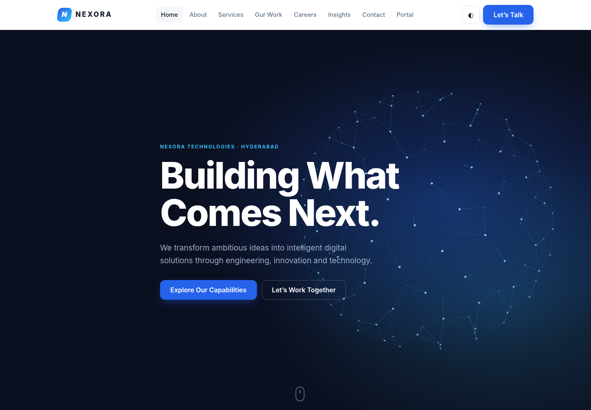
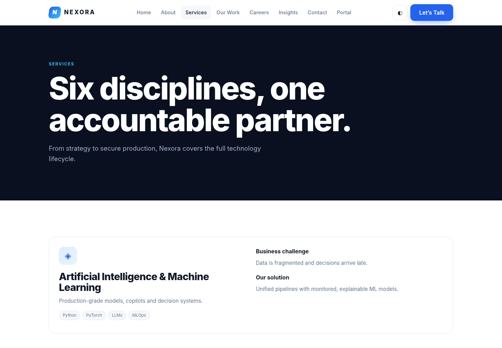
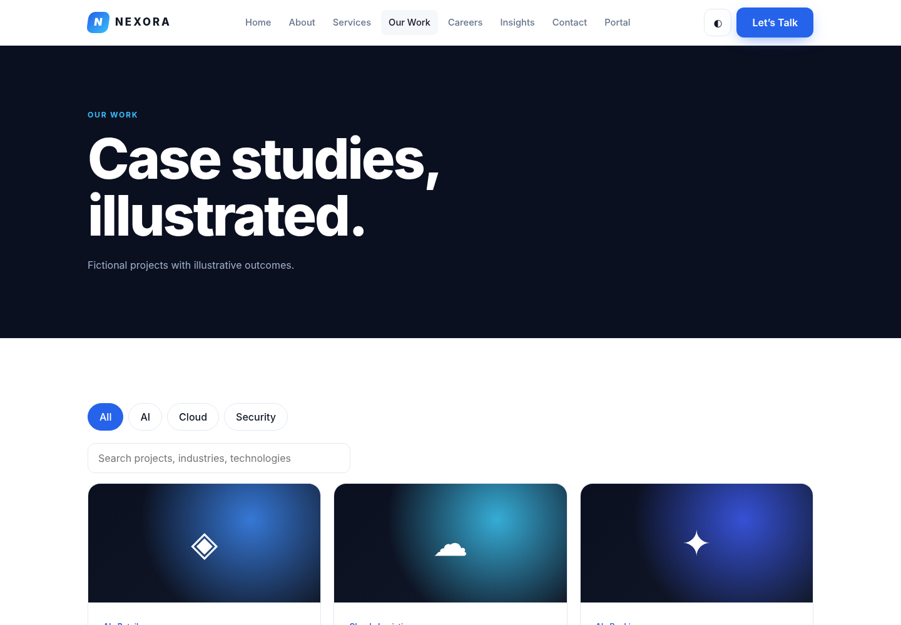

# NEXORA Technologies — Corporate Website

<p align="center">
  
</p>

<p align="center">
  <strong>Building What Comes Next.</strong><br />
  A futuristic, responsive technology-company website concept created for the <strong>PIXEL WARS X26</strong> competition.
</p>

<p align="center">
  
  
  
  
</p>

## About the Project

**NEXORA Technologies** is a fictional technology company website concept. The website presents a modern digital engineering brand offering services across artificial intelligence, cloud infrastructure, full-stack software development, cybersecurity, digital transformation and enterprise solutions.

The main goal of this project was to build an engaging, multi-section corporate website with a futuristic visual style, interactive components and a responsive layout using core frontend technologies.

> **Important:** NEXORA Technologies is a fictional demo brand created for the PIXEL WARS X26 competition. It is not a real company. The projects, team profiles, contact details, vacancies, statistics and dashboard information shown on the website are illustrative sample content.

## Website Preview

### 1. Home Page

The landing page features a dark futuristic hero section, animated particle network, navigation, and calls to action.


### 2. Services Section

The services area introduces the six technology disciplines represented in the website concept.



### 3. Our Work / Case Studies

The work section displays fictional sample case studies with category filters, search and additional case-study details.



## Features

- **Responsive design:** Layout adapts to desktop, tablet and mobile screen sizes.
- **Multi-section navigation:** Home, About, Services, Our Work, Careers, Insights, Contact and Portal.
- **Modern visual design:** Dark navy backgrounds, blue/cyan gradients, cards, typography and subtle transitions.
- **Animated hero background:** Canvas-based particle network that responds to pointer movement.
- **Light and dark appearance:** Theme toggle for switching the page appearance.
- **Services overview:** Six technology service areas with descriptions and technology examples.
- **Project showcase:** Fictional case studies with category filters, search and detail pop-ups.
- **Careers section:** Sample job listings with role details and a demo application form.
- **Insights section:** Sample technology articles with category filters and search.
- **Client portal concept:** Demo sign-in screen and dashboard containing sample project data, charts, metrics and filters.
- **Contact experience:** Contact form, inquiry categories and FAQ section.
- **User experience details:** Scroll animations, modal dialogs, mobile navigation, back-to-top control, form validation and reduced-motion support.
- **Frontend-only interactions:** Forms and account screens demonstrate interface behaviour without connecting to a real backend.

## Technology Stack

| Technology | Usage |
|---|---|
| HTML5 | Website structure and semantic content |
| CSS3 | Responsive layouts, styling, gradients, animations and themes |
| Vanilla JavaScript | Navigation, filters, search, modal windows, form validation and dashboard interactions |
| HTML Canvas | Animated particle-network hero background |
| Google Fonts — Inter | Website typography (loaded from Google Fonts when internet access is available) |

This project currently uses plain HTML, CSS and JavaScript. It does not require a frontend framework or package installation.

## Website Sections

| Section | Description |
|---|---|
| Home | Hero banner, company introduction, services preview, sample metrics and featured work |
| About | Fictional company story, mission, vision, values, team profiles and timeline |
| Services | AI/ML, cloud, full-stack development, cybersecurity, digital transformation and enterprise solutions |
| Our Work | Searchable and filterable fictional case studies |
| Careers | Sample vacancies and a frontend-only application form |
| Insights | Sample technology articles with filters and search |
| Contact | Demo contact details, inquiry form and frequently asked questions |
| Portal | Sample sign-in and interactive client dashboard concept |

## Getting Started

You can run this project locally without installing any dependencies.

### 1. Clone the repository

```bash
git clone https://github.com/Avinash-Sunkara/NEXORA.git
```

### 2. Open the project folder

```bash
cd NEXORA
```

### 3. Run the website

Open `index.html` directly in your browser, or use the **Live Server** extension in Visual Studio Code:

1. Open the project folder in VS Code.
2. Install the Live Server extension if it is not already installed.
3. Right-click `index.html`.
4. Select **Open with Live Server**.

No build command is required.

## Project Structure

```text
NEXORA/
│
├── index.html
├── README.md
├── nexora-home.png
├── nexora-services.png
└── nexora-work.png
```

Keep the screenshot files alongside `README.md` when uploading the project to GitHub so that they appear correctly in the README.

## Current Limitations

This is **not the complete or final version** of the project. During development, I faced several technical challenges and internet/connectivity issues. Because of these difficulties and limited development time, I could not complete every idea or take the website to the level I originally planned.

Some parts are currently demonstrations only:

- Contact, newsletter and job application forms do not submit data to a backend.
- The client portal uses sample data and does not provide real authentication or account storage.
- Company details, employee profiles, job vacancies, project case studies and performance figures are fictional examples.
- There is no database, server-side application or live API integration at this stage.

I am sharing this version as my current progress and as a record of what I have learned while building the project.

## Future Improvements

I definitely plan to upgrade this project to the next level. My future goals include:

- Build a proper backend and database integration.
- Implement secure user registration, login and authentication for the client portal.
- Connect contact, newsletter and application forms to real services.
- Add real API integrations and dynamic data wherever required.
- Improve performance, accessibility, responsiveness and cross-browser compatibility.
- Refine the UI/UX, animations and dashboard experience.
- Add more advanced features and complete the remaining planned functionality.

## What I Learned

While developing this project, I practised building a multi-section website, creating responsive layouts, using JavaScript for interactive UI behaviour, working with the Canvas API, implementing filters and search, and handling basic frontend form validation. I also learned that completing a project involves troubleshooting, testing and improving the work—not just writing code.

## A Note from the Developer

This project may not be perfect, and it is not yet the full version I imagined. I faced a lot of technical and internet-related issues during development, which affected the final result. Still, I did not want to leave the work undocumented. I am proud of the progress I have made and the experience I gained from this attempt.

**This is only the beginning. In the future, I will definitely improve and upgrade NEXORA Technologies to the next level.** Thank you for checking out my project!

---

<p align="center">
  Made with dedication, curiosity and a passion for learning.<br />
  <strong>NEXORA Technologies — Engineering Tomorrow. Empowering Today.</strong>
</p>
